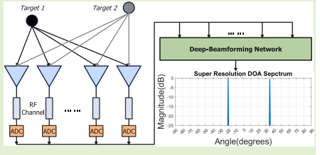
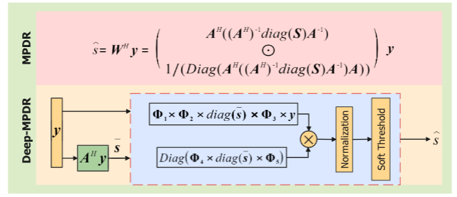
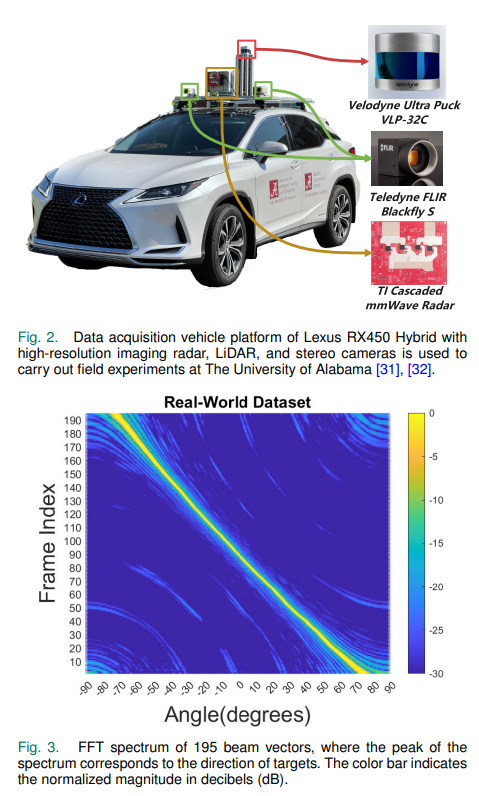
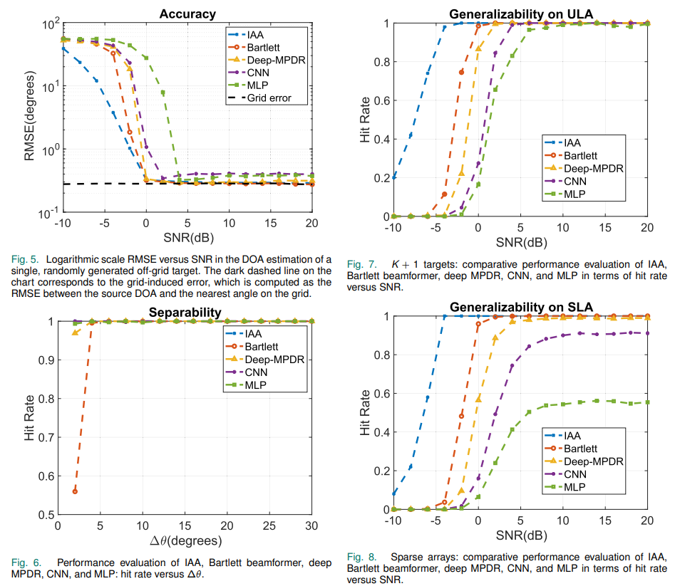
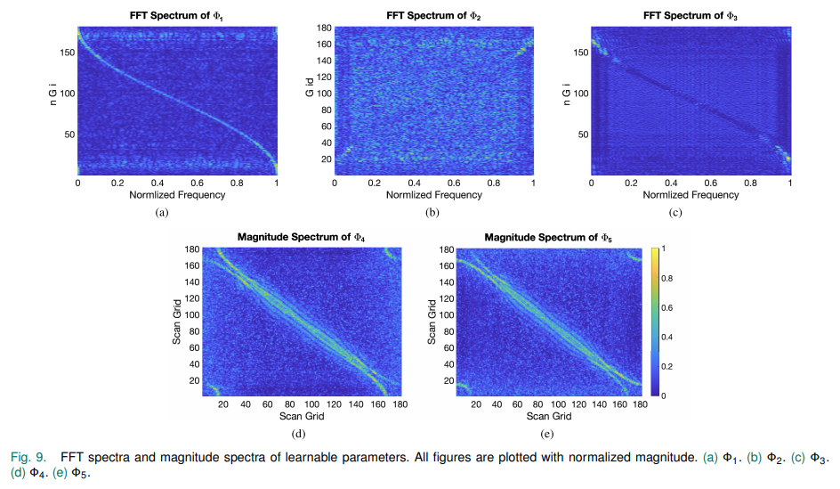
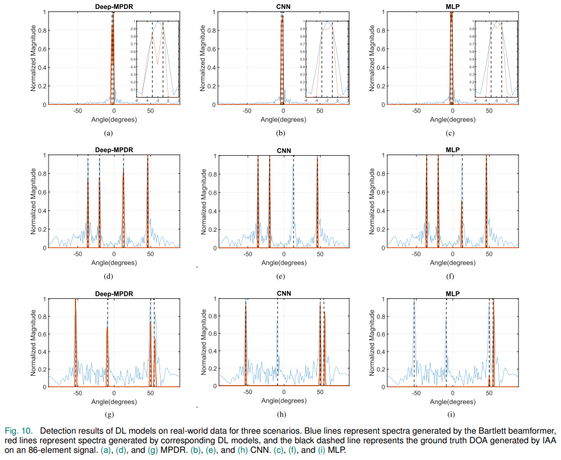

# [DOA Estimation] Explanable and Efficient Deep Learning Method for Single-Shot Direction Estimation Based on Beamforming [with MATLAB+Python Codes]

We introduce an interpretable deep learning (DL) method for single-snapshot direction of arrival (DOA) estimation. Classical subspace methods, such as Multiple Signal Classification (MUSIC) and Rotating Invariant Techniques for Parameter Estimation (ESPRIT), use spatial smoothing on uniform linear arrays (ULAs) for single-snapshot DOA estimation, but suffer from reduced aperture size and inapplicability to sparse arrays. Single-snapshot methods, such as Compressed Sensing (CS) and Iterative Adaptive Algorithms (IAA), face challenges with high computational cost and slow convergence, hindering real-time applications. Recent DL DOA methods show promising prospects in terms of accuracy and speed. However, the black-box nature of deep networks hinders their practical deployment. To address this issue, we propose a Deep Minimum Power Undistorted Response (MPDR) network that converts MPDR beamformers into DL, enhancing generalization capability and efficiency. Comprehensive experiments using both simulated and real datasets demonstrate its advantages over traditional methods in terms of inference time and accuracy. Moreover, it outperforms other DL DOA estimation networks in terms of efficiency, generalization capacity, and interpretability.
Introduction
Direction of Arrival (DOA) estimation, often referred to as ranging, is a critical process in sensor array signal processing and various engineering fields such as radar, radio astronomy, sonar, navigation, remote sensing, wireless communication, biomedical engineering, and speech processing. Despite extensive research in the literature, numerous algorithms have been proposed and their performance has been comprehensively analyzed. However, these works mostly focus on the asymptotic scenario with a large number of snapshots. In dynamically changing scenarios, such as those encountered in real-world automotive radar applications, available DOA estimation data are typically limited to a small number of radar sensor array snapshots or, in the most challenging cases, even just one snapshot.
The exploration of DOA estimation methods has a significant historical trajectory. The traditional (Bartlett) beamformer can be traced back to World War II, which used the Fourier-based spectral analysis on time-space sampled data but was limited by high sidelobe levels and Rayleigh resolution. Subsequently, the introduction of the minimum power undistorted response (MPDR) beamformer and the minimum variance undistorted response (MVDR) beamformer, commonly known as Capon beamformers, aimed to enhance source estimation in scenarios with closely spaced sources. MPDR minimizes its output power subject to the constraint that the target signal remains undistorted in the output while MVDR prioritizes the power of specified directions of signals while suppressing interference and noise from other angles.
In addition to beamforming methods, parameter subspace based approaches, including multiple signal classification (MUSIC) and rotationally invariant techniques parameter estimation (ESPRIT) and their respective variants, retrieve DOA from data's second order statistics. DOA estimation can also utilize nonlinear least squares (NLS), often referred to as deterministic maximum likelihood (DML) estimation. DML typically requires multidimensional grid search in the parameter space to determine the global minimum. Clearly, this exhaustive multidimensional search strategy has exponential computational complexity with respect to the number of sources.
However, these methods have well-known limitations. Technical approaches based on subspace and NLS require prior knowledge of the source number, which may be difficult to obtain. Techniques based on covariance, such as Capon beamformers, MUSIC, and ESPRIT, rely on sufficient data samples to accurately estimate the data covariance matrix, and may be affected by source correlation, leading to a rank deficiency in the sampled data covariance matrix. Although spatial smoothing can alleviate some challenges by generating a smaller average covariance matrix, it is worth noting that this technique is only applicable to uniform linear arrays (ULA), and not to sparse arrays. Additionally, spatial smoothing leads to a reduction in the effective aperture size of the array. In addition to these considerations, it is important to note that super-resolution methods typically require significant computational overhead, involving processes such as singular value decomposition (SVD), eigenvalue decomposition, covariance matrix inversion or angle scanning.
In this paper, we propose an interpretable and efficient deep learning network called Deep MPDR, which maps the principles of MPDR beamforming to the deep learning framework. MPDR beamforming is inherently interpretable because it models physical processes using domain knowledge. Our method improves interpretability by simulating the characteristics of MPDR beamforming compared to traditional deep neural networks. Through comprehensive experiments using both simulated and real datasets under various signal-to-noise ratio (SNR) scenarios, we demonstrate that Deep MPDR outperforms traditional algorithms in terms of inference time and DOA estimation accuracy. Moreover, Deep MPDR surpasses data-driven DL methods in terms of parameter efficiency and generalization capability. These findings highlight the great potential of Deep MPDR as a promising solution for DOA estimation challenges, offering enhanced performance and interpretability compared to existing techniques.
Conclusion
By leveraging the advantages of MPDR beamforming and the latest DL-based DOA estimation techniques, our deep MPDR network transforms the MPDR beamformer into a DL framework. By integrating domain knowledge, our deep MPDR model uses fewer parameters while providing an interpretable and efficient solution for high-resolution angle measurement in single-snapshot scenarios. It achieves rapid inference time by avoiding the high computational cost associated with large matrix inversion, and demonstrates superior generalization capabilities compared to purely data-driven DL methods. We have proven the superior performance of our deep MPDR network through extensive numerical experiments conducted on both simulated and real datasets. This innovative approach showcases strong performance in controlled environments and holds promise for real-time DOA estimation applications in automotive radar scenarios.

## Images

<!-- PAYMENT_BLOCK -->

## Get this dataset

- Payment link (Stripe): [Buy now](https://buy.stripe.com/3cs8yP7sY87d0vu9AB)
- Payment QR code: 

<!-- /PAYMENT_BLOCK -->
